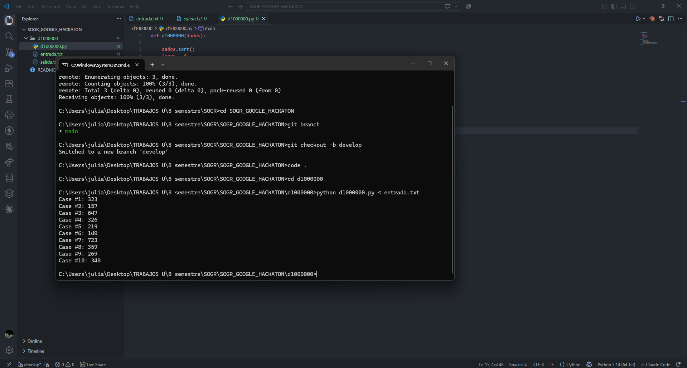
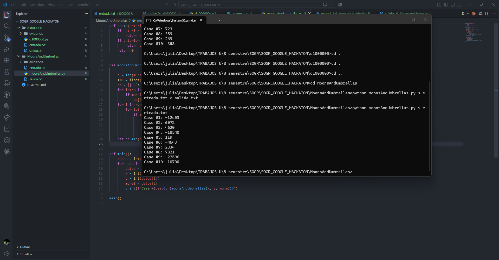
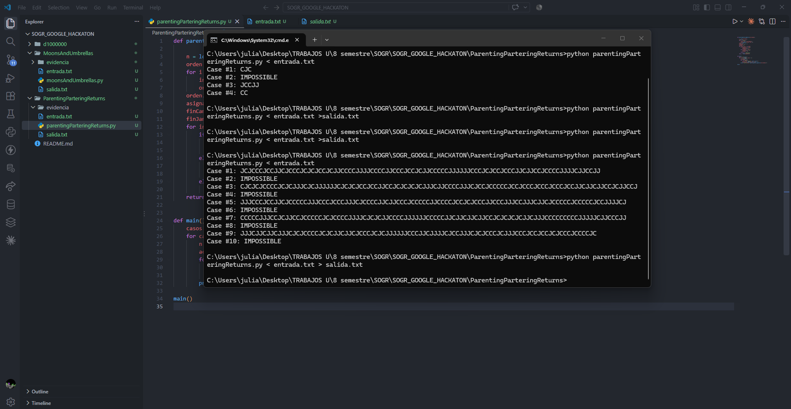
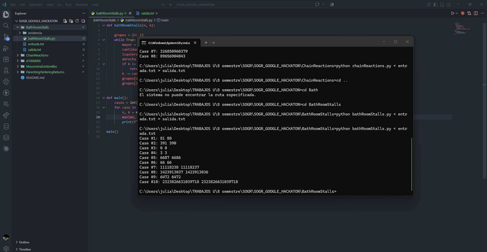
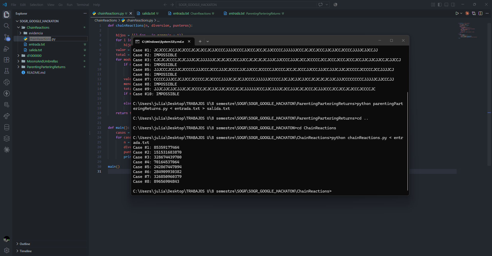

# SOGR_GOOGLE_HACKATON

- **Estudiante:** Julian Camilo Lopez
- **Materia:** SOGR
- **Profesor:** Martín Cantor

## Contenido del proyecto

Este repositorio contiene la solución en Python de cinco problemas de las rondas de clasificación de Google Code Jam. Cada problema tiene su propia carpeta con:

- `<nombre>.py`: la solución.
- `entrada.txt`: los casos de prueba.
- `salida.txt`: la salida que produce el programa.
- `evidencia/`: captura de la ejecución.

| Ejercicio | Carpeta |
|---|---|
| d1000000 | [d1000000/](d1000000/) |
| Moons and Umbrellas | [MoonsAndUmbrellas/](MoonsAndUmbrellas/) |
| Parenting Partnering Returns | [ParentingParteringReturns/](ParentingParteringReturns/) |
| Bathroom Stalls | [BathRoomStalls/](BathRoomStalls/) |
| Chain Reactions | [ChainReactions/](ChainReactions/) |

Para ejecutar cualquiera de los ejercicios:

```bash
python d1000000/d1000000.py < d1000000/entrada.txt
```

## Evidencias

### d1000000



### Moons and Umbrellas



### Parenting Partnering Returns



### Bathroom Stalls



### Chain Reactions


